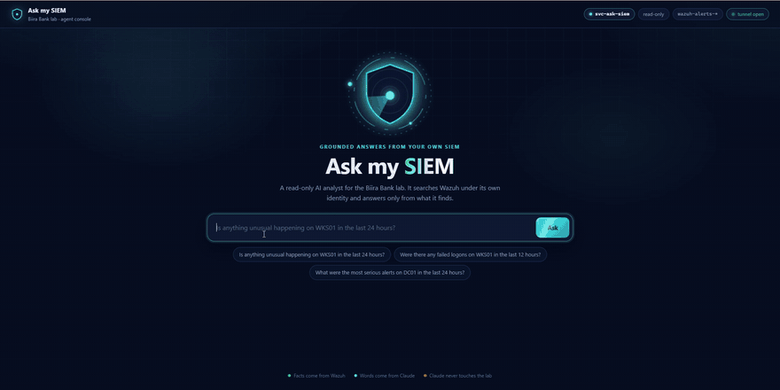

# AI Agent Identity Lab

**Securing AI agents the way we secure people and service accounts: each one gets
its own identity, the least access that does the job, and an audit trail.**

*Project 01 in action: an AI agent answering a question about a real SIEM, under
its own read-only identity.*

## Why this lab exists

AI agents are becoming a new kind of user. They read data, call tools and act on
systems, and most of them run with someone's full credentials and no record of
what they did. That is an identity problem before it is an AI problem, and it is
the problem this lab works on, one hands-on project at a time:

- **Who is the agent?** Its own account, never a shared or personal one.
- **What may it touch?** The smallest permission that answers the question,
  proven by showing what it is refused.
- **What leaves the network?** Everything an agent sees is sent to a model
  provider, so data is filtered before it goes.
- **Can it be fooled?** Agents read text written by others; that text must never
  become instructions.
- **Can we see what it did?** Every action attributable to the agent's identity.

Everything runs in my own labs, against a fictional company, Biira Bank. No real
company's systems or data are involved.

## Start here

### [01. Ask my SIEM: an AI agent with its own identity](01-agent-from-scratch/)

A read-only agent that answers plain questions about the lab's Wazuh SIEM. The AI
never touches the lab: it asks, my code searches under a dedicated account, and
secrets are stripped before anything leaves. Includes the 401/403 proof of its
permissions, a verified TLS connection, a tested secret filter, and a case where
the agent found a bug in its own tool.

It can also look up machines and accounts, signing in to Active Directory over
LDAPS as its own AD account and reading allow-listed attributes only.

It runs two ways, on a loop written by hand and on the Anthropic SDK's Tool
Runner, with the same guardrails in both.

**Status:** complete.

## All projects

| # | Project | Status |
|---|---------|--------|
| 01 | [Ask my SIEM: an AI agent with its own identity](01-agent-from-scratch/) | **Complete** · Wazuh + AD lookups, hand loop and Tool Runner |
| 02 | Okta MCP server | Planned |
| 03 | Agent identity with Okta + Vault | Planned |
| 04 | Service account hunter | Planned |
| 05 | AI-assisted access review | Planned |
| 06 | JIT access broker | Planned |
| 07 | Secretless cloud access | Planned |
| 08 | SPIFFE/SPIRE workload identity | Planned |
| 09 | Prompt injection red team | Planned |
| 10 | Wazuh agent detection | Planned |
| 11 | Governed support assistant (capstone) | Planned |

Each project has its own folder with what it does, why each design decision was
made, evidence, and what broke along the way. This table is updated as they land.

## The labs it runs on

- **Security homelab** (Proxmox, Windows Server AD, Wazuh, pfSense, six VLANs):
  https://github.com/noble-antwi/enterprise-security-homelab. Project 01's SIEM
  lives here.
- **Enterprise IAM lab** (hybrid AD + Okta): https://github.com/noble-antwi/enterprise-iam-lab
